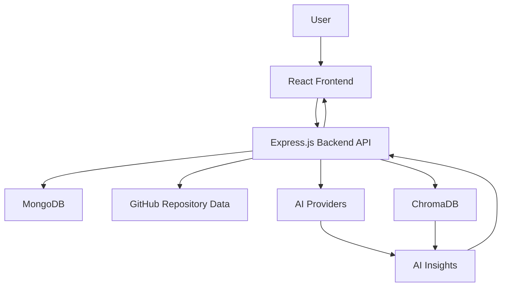

# 🚀 RepoIQ AI

### Understand, Analyze, and Improve Your Repositories with AI

RepoIQ AI is an AI-powered GitHub repository analyzer that helps developers understand codebases, explore repository history, identify code hotspots, and gain AI-driven insights.

🌐 **Live Demo:** https://repo-iq-ai-c5v9.vercel.app/

📂 **GitHub Repository:** https://github.com/Shibnath-Maity/RepoIQ-AI

---

## ✨ Features

### 📊 Repository Analysis
- Analyze GitHub repositories.
- Explore repository structure and development history.
- Inspect commit activity and contributor information.
- Identify potential code hotspots.

### 🤖 AI-Powered Insights
- Generate AI-based repository explanations.
- Understand complex code changes.
- Explore AI-assisted issue-solving capabilities.
- Get contextual insights into repository development.

### 📈 Interactive Visualizations
- Visualize repository activity and development patterns.
- Explore contributor statistics.
- View repository insights through interactive charts and graphs.

### 🔐 Authentication
- User registration and login.
- JWT-based authentication.
- Protected application features.

### 🎨 Modern Interface
- Responsive React interface.
- Interactive dashboards.
- Dark-themed UI.
- Smooth navigation and data visualization.

---

## 🛠️ Tech Stack

| Technology | Purpose |
|---|---|
| React | Frontend development |
| Vite | Frontend build tooling |
| Tailwind CSS | UI styling |
| Recharts | Data visualization |
| React Flow | Interactive visualizations |
| Node.js | Backend runtime |
| Express.js | REST API |
| MongoDB | Database |
| JWT | Authentication |
| Axios | API communication |
| Simple Git | Git repository operations |
| ChromaDB | Vector storage for AI retrieval |
| Groq API | AI-powered responses |
| Google Gemini | AI and embedding capabilities |
| Vercel | Frontend deployment |
| Render | Backend deployment |

---

## 🏗️ Architecture



---

## 📁 Project Structure

```text
RepoIQ-AI/
├── client/
│   ├── src/
│   │   ├── components/
│   │   ├── pages/
│   │   ├── services/
│   │   └── ...
│   ├── public/
│   └── package.json
│
├── server/
│   ├── config/
│   ├── models/
│   ├── routes/
│   ├── controllers/
│   ├── services/
│   ├── app.js
│   └── package.json
│
└── README.md
```

---

## 🌐 Live Deployment

| Component        | Platform | Link                                                                                       |
| ---------------- | -------- | ------------------------------------------------------------------------------------------ |
| Live Application | Vercel   | [https://repo-iq-ai-c5v9.vercel.app/](https://repo-iq-ai-c5v9.vercel.app/)                 |
| Source Code      | GitHub   | [https://github.com/Shibnath-Maity/RepoIQ-AI](https://github.com/Shibnath-Maity/RepoIQ-AI) |

The frontend and backend are deployed separately. Production API configuration and connected services are required for the application's features to work correctly.

---

## ⚙️ Environment Configuration

Configure the required environment variables in your deployment platforms.

### Backend Environment Variables

| Variable              | Description                                    |
| --------------------- | ---------------------------------------------- |
| `MONGO_URI`           | MongoDB connection string                      |
| `JWT_SECRET`          | Secret used for JWT authentication             |
| `CLIENT_URL`          | Deployed frontend origin                       |
| AI provider variables | Credentials required by configured AI services |

### Frontend Environment Variables

| Variable       | Description                            |
| -------------- | -------------------------------------- |
| `VITE_API_URL` | Public URL of the deployed backend API |

Never commit API keys, database credentials, or other secrets to GitHub.

---

## 🚀 Running the Project

### Prerequisites

* Node.js and npm
* Git
* MongoDB
* Required AI provider API credentials

### 1. Clone the Repository

```bash
git clone https://github.com/Shibnath-Maity/RepoIQ-AI.git
cd RepoIQ-AI
```

### 2. Install Backend Dependencies

```bash
cd server
npm install
```

Configure the required backend environment variables before starting the server.

### 3. Start the Backend

```bash
npm start
```

Use the start script defined in the backend's `package.json`.

### 4. Install Frontend Dependencies

Open another terminal from the project directory:

```bash
cd client
npm install
```

Configure `VITE_API_URL` with the public URL of your deployed backend API.

### 5. Start the Frontend

```bash
npm run dev
```

Open the URL provided by Vite in your terminal.

---

## 🔮 Future Improvements

* [ ] Advanced repository analytics.
* [ ] More detailed code evolution visualizations.
* [ ] Improved AI-generated code explanations.
* [ ] Enhanced issue analysis and resolution suggestions.
* [ ] Better support for large repositories.
* [ ] Improved performance and caching.
* [ ] Comprehensive automated testing.
* [ ] Additional security improvements.

---

## 👨‍💻 Author

**Shibnath Maity**

B.Tech Computer Science and Engineering

* GitHub: [https://github.com/Shibnath-Maity](https://github.com/Shibnath-Maity)
* LinkedIn: [https://www.linkedin.com/in/shibnathmaitycse2006/](https://www.linkedin.com/in/shibnathmaitycse2006/)

---

## ⭐ Support

Explore the live application and check out the source code.

If you find this project interesting, consider giving the repository a ⭐ on GitHub.

**Built with ❤️ to make understanding codebases easier with AI.**
